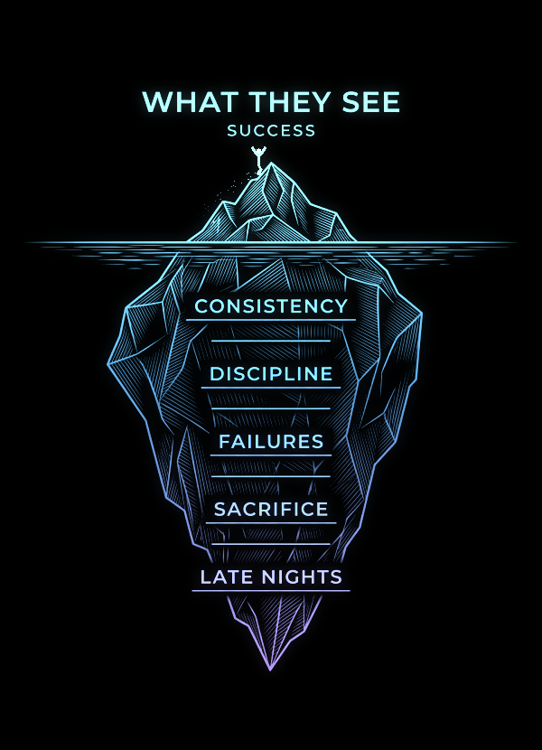
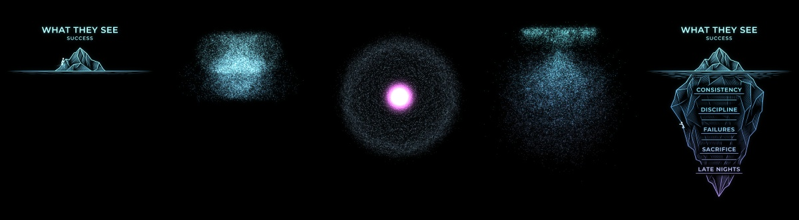
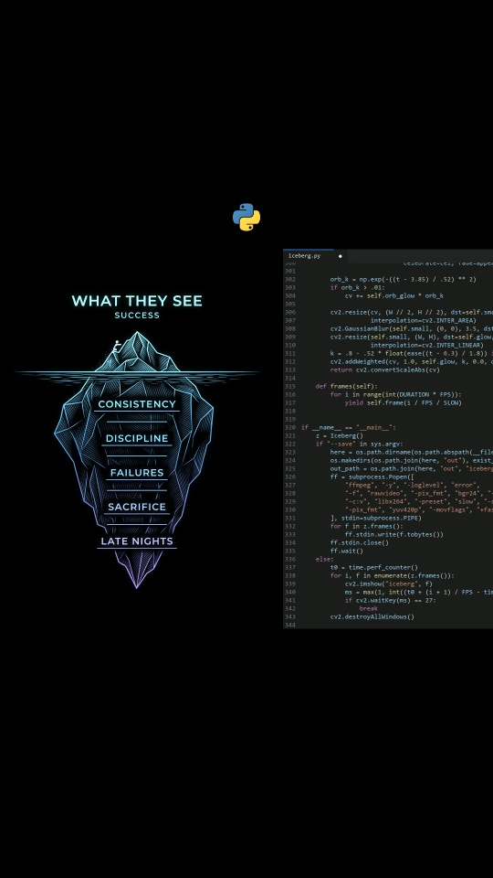

# particle-iceberg

A small iceberg tip above the waterline where a stick figure easily walks to the top, before 15,000 particles reveal the colossal mountain hidden beneath and the real climb upward.

`iceberg.py` animates the line engraving (`iceberg.png`) and procedural figure with NumPy and OpenCV.

<p align="center">
  
</p>

## What happens



1. A stick figure walks along the waterline and easily steps up the visible tip under "WHAT THEY SEE / SUCCESS".
2. Everything shatters and pulls into a spinning 3D particle sphere.
3. A flash of light at the center of the sphere.
4. Every particle swirls downward to form the full hidden iceberg beneath the surface.
5. Light sweeps across the full engraving while the figure climbs the entire submerged ridge from the bottom up to the summit.

The whole thing runs for 16 seconds at 60 FPS.

## Run it

Double-click `start.bat` on Windows (or run `python start.py`) to install dependencies automatically and choose a mode, or run manually:

```bash
pip install -r requirements.txt
python iceberg.py           # live window, ESC to quit
python iceberg.py --save    # writes out/iceberg.mp4
```

## Vertical video

`make_reel.py` renders a 1080x1920 video with the animation on the left and the source scrolling on the right.

<p align="center">
  
</p>

```bash
python make_reel.py         # out/iceberg_reel.mp4
```

It pipes frames into `ffmpeg`, so that needs to be on your PATH. The code panel uses Consolas from the Windows fonts folder; change `FONT` in `make_reel.py` on macOS or Linux.

## Settings

At the top of `iceberg.py`:

| Setting | What it does |
|---|---|
| `N` | number of particles |
| `FPS` | frame rate |
| `DURATION` | length in seconds |
| `SLOW` | stretches or squeezes the timing |
| `TOP`, `MID`, `BOT` | gradient colors (BGR) |
| `ORB` | color of the flash |
| `IMAGE` | the drawing to use; any black line art on white works |

## License

[MIT](LICENSE)
